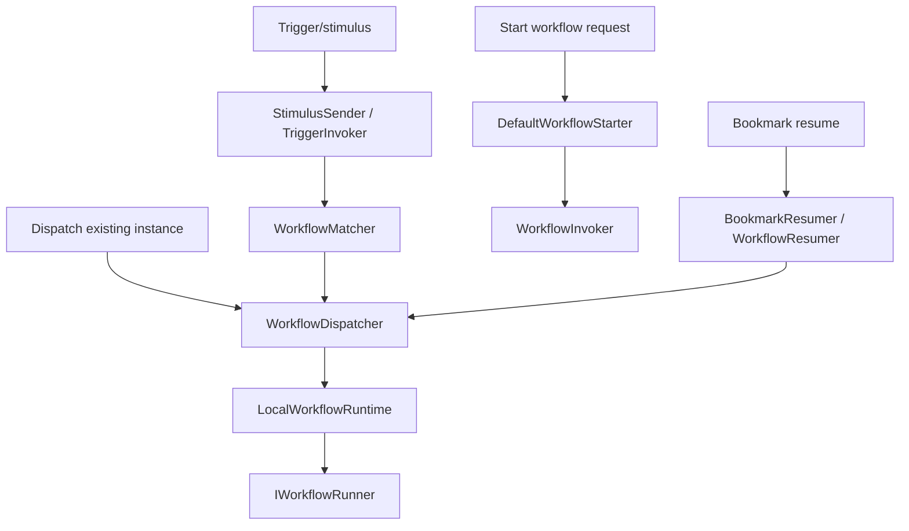

# Workflow Runtime

Workflow runtime owns starting, dispatching, resuming, canceling, logging, and recovering workflow executions. It is the layer that turns definitions into running instances and responds to triggers, bookmarks, background work, and admin operations.

Start in [src/modules/Elsa.Workflows.Runtime](../../src/modules/Elsa.Workflows.Runtime).

## Feature Wiring

[WorkflowRuntimeFeature](../../src/modules/Elsa.Workflows.Runtime/Features/WorkflowRuntimeFeature.cs) registers and configures:

- `IWorkflowRuntime`
- `IWorkflowDispatcher`
- `IStimulusDispatcher`
- `IWorkflowCancellationDispatcher`
- runtime stores:
  - bookmark, bookmark queue, bookmark queue dead-letter, trigger, workflow execution log, and activity execution stores
- workflow matcher, starter, invoker, resumer, canceler, restarter
- trigger indexer and bookmark manager
- background workflow, stimulus, task, and activity dispatch
- bookmark queue worker and queue purger
- distributed lock provider
- execution cycle registry
- graceful shutdown machinery
- runtime startup and recurring tasks

It also configures `WorkflowsFeature` to use the runtime commit state handler.

## Runtime Stores

Important runtime entities:

- [StoredTrigger](../../src/modules/Elsa.Workflows.Runtime/Entities/StoredTrigger.cs)
- [StoredBookmark](../../src/modules/Elsa.Workflows.Runtime/Entities/StoredBookmark.cs)
- [BookmarkQueueItem](../../src/modules/Elsa.Workflows.Runtime/Entities/BookmarkQueueItem.cs)
- [BookmarkQueueDeadLetterItem](../../src/modules/Elsa.Workflows.Runtime/Entities/BookmarkQueueDeadLetterItem.cs)
- [WorkflowExecutionLogRecord](../../src/modules/Elsa.Workflows.Runtime/Entities/WorkflowExecutionLogRecord.cs)
- [ActivityExecutionRecord](../../src/modules/Elsa.Workflows.Runtime/Entities/ActivityExecutionRecord.cs)
- [WorkflowInboxMessage](../../src/modules/Elsa.Workflows.Runtime/Entities/WorkflowInboxMessage.cs)

The default runtime feature uses memory stores. EF Core runtime persistence is wired by [EFCoreWorkflowRuntimePersistenceFeature](../../src/modules/Elsa.Persistence.EFCore/Modules/Runtime/WorkflowRuntimePersistenceFeature.cs), which replaces runtime store factories on `WorkflowRuntimeFeature`.

## Dispatch Paths



Key files:

- [LocalWorkflowRuntime](../../src/modules/Elsa.Workflows.Runtime/Services/LocalWorkflowRuntime.cs)
- [BackgroundWorkflowDispatcher](../../src/modules/Elsa.Workflows.Runtime/Services/BackgroundWorkflowDispatcher.cs)
- [TransactionalWorkflowDispatcher](../../src/modules/Elsa.Workflows.Runtime/Services/TransactionalWorkflowDispatcher.cs)
- [ValidatingWorkflowDispatcher](../../src/modules/Elsa.Workflows.Runtime/Services/ValidatingWorkflowDispatcher.cs)
- [WorkflowInvoker](../../src/modules/Elsa.Workflows.Runtime/Services/WorkflowInvoker.cs)
- [DefaultWorkflowStarter](../../src/modules/Elsa.Workflows.Runtime/Services/DefaultWorkflowStarter.cs)
- [WorkflowResumer](../../src/modules/Elsa.Workflows.Runtime/Services/WorkflowResumer.cs)
- [BookmarkResumer](../../src/modules/Elsa.Workflows.Runtime/Services/BookmarkResumer.cs)
- [TriggerInvoker](../../src/modules/Elsa.Workflows.Runtime/Services/TriggerInvoker.cs)

## Correlation IDs And Activation Strategies

`CorrelationId` groups and routes instances. It is not a unique identity unless the workflow opts into an activation strategy. The decision is recorded in [Refuse duplicate running instances through activation strategies](../../../docs/adr/2026-09-15-correlated-workflow-activation.md).

| Strategy | Running-instance uniqueness | Blank `CorrelationId` |
| --- | --- | --- |
| None / `AllowAlwaysStrategy` (default) | None. Many Running instances may share a correlation ID. | Many |
| `CorrelatedSingletonStrategy` | At most one Running instance per `(TenantId, DefinitionId, CorrelationId)`. Different definitions and tenants have separate scopes. | Fails explicitly; a non-blank value is required |
| `CorrelationStrategy` | At most one Running instance per `(TenantId, CorrelationId)` across definitions. | Fails explicitly; a non-blank value is required |
| `SingletonStrategy` | At most one Running instance per `(TenantId, DefinitionId)`. | N/A |

`StartWorkflow` and `DispatchWorkflowDefinition` both evaluate the strategy at the shared create boundary. Built-in lock names are deterministic hashes of canonical, tenant-scoped strategy components; raw tenant and correlation values are not logged or embedded in lock names. Create-only requests persist under the lease. Create-and-run keeps the candidate in memory until the runner's first durable commit and holds the lease through that point, so a pre-commit failure or cancellation does not leave a phantom Running/Pending instance. A refused create returns `CannotStart` without an instance ID and does not attach to or resume the existing instance. Later events for the same conversation should resume through stimulus / bookmarks, not by dispatching the definition again. A configured but unregistered strategy fails closed with a registration/configuration error.

Custom `IWorkflowActivationStrategy` implementations are still evaluated without requiring an interface change, but their exclusivity scope is unknown and the runtime does not claim distributed atomicity for them. Synchronously awaited nested dispatch using the same built-in activation scope can wait on its parent-held lease; use a distinct correlation scope for that nested activation.

Conversation workflows that treat `CorrelationId` as the identity of a long-running process should set `CorrelatedSingletonStrategy` (or `CorrelationStrategy` when the conversation key is process-wide). Clustered hosts must use a cross-node `IDistributedLockProvider`; the default file-system provider only coordinates on one node.

Do not add a unique database index on `CorrelationId`. That would collapse the three scopes above and reject blank correlation IDs.

## Transactional Dispatch Outbox

Hosts can opt into at-least-once workflow dispatch for dispatch calls made from inside a running workflow, including child workflow dispatches and in-workflow asynchronous event publications (`PublishEvent` / `IEventPublisher.PublishAsync(..., asynchronous: true)`):

```csharp
services.Configure<WorkflowDispatcherOptions>(options =>
{
    options.UseTransactionalOutbox = true;
});
```

When enabled, [TransactionalWorkflowDispatcher](../../src/modules/Elsa.Workflows.Runtime/Services/TransactionalWorkflowDispatcher.cs) writes the command to [IWorkflowDispatchOutboxStore](../../src/modules/Elsa.Workflows.Runtime/Contracts/IWorkflowDispatchOutboxStore.cs) before the parent workflow state commits, and stores the outbox item ID in the parent `WorkflowState.Properties`. [WorkflowDispatchOutboxProcessor](../../src/modules/Elsa.Workflows.Runtime/Services/WorkflowDispatchOutboxProcessor.cs) delivers only records whose owner workflow state contains that committed marker. This prevents a crash between workflow-state commit and mediator enqueue from silently losing the dispatch: the durable outbox record is already present, and the committed marker authorizes delivery after restart.

Operational notes:

- The default outbox store uses `IKeyValueStore`; production hosts should pair this option with durable workflow instance persistence and durable key-value persistence.
- Delivery is at-least-once. If the process crashes after sending a command but before deleting the outbox record, the processor may send it again.
- Workflow definition dispatches generated by `DispatchWorkflow`/`BulkDispatchWorkflows` include a child workflow instance ID. [DispatchWorkflowRequestHandler](../../src/modules/Elsa.Workflows.Runtime/Handlers/DispatchWorkflowRequestHandler.cs) treats that ID as the idempotency key for outbox-routed commands and skips duplicate create-and-run attempts when the instance already exists.
- Outbox processing is serialized with the configured distributed lock provider. Poison items are abandoned after `WorkflowDispatcherOptions.MaxOutboxDeliveryAttempts`, and missing-owner items are removed after `WorkflowDispatcherOptions.OrphanedOutboxItemRetention`.
- Dispatch calls outside a workflow execution context, including API-triggered asynchronous events, continue to use the regular background dispatcher.
- In-workflow `PublishEvent` and asynchronous `IEventPublisher` calls use `IWorkflowDispatcher` (`DispatchTriggerWorkflowsRequest`) so `TransactionalWorkflowDispatcher` applies. They do not go through `IStimulusDispatcher` / `BackgroundStimulusDispatcher`.

### Customizing outbox marker cleanup

After successfully deleting a delivered or abandoned outbox item, the processor calls
[IWorkflowDispatchOutboxMarkerCleaner](../../src/modules/Elsa.Workflows.Runtime/Contracts/IWorkflowDispatchOutboxMarkerCleaner.cs)
to remove the item's committed marker from its owner workflow. The default
[WorkflowDispatchOutboxMarkerCleaner](../../src/modules/Elsa.Workflows.Runtime/Services/WorkflowDispatchOutboxMarkerCleaner.cs)
acquires `workflow-instance:{OwnerWorkflowInstanceId}` using the configured distributed lock provider,
reloads the owner, removes only that marker and saves the owner. Missing owners and already-removed markers require no save.

Hosts whose workflow state writes require additional ownership, such as a database session lock acquired
before loading state, can replace this scoped service without replacing the outbox processor:

```csharp
using Elsa.Workflows.Runtime;
using Microsoft.Extensions.DependencyInjection;
using Microsoft.Extensions.DependencyInjection.Extensions;

// ApplicationOutboxMarkerCleaner is the host's IWorkflowDispatchOutboxMarkerCleaner implementation.
services.Replace(ServiceDescriptor.Scoped<IWorkflowDispatchOutboxMarkerCleaner, ApplicationOutboxMarkerCleaner>());
```

Both module and shell runtime registration use `TryAddScoped`, so registering a custom cleaner before runtime
registration also works. Existing processor constructors retain their default cleanup behavior. Code that manually
constructs a processor can use the overload whose first argument is `IWorkflowDispatchOutboxMarkerCleaner`.

The cleaner receives the full outbox item, including its tenant and owner identifiers. It must use the owner ID,
which can differ from the dispatched child or resumed workflow ID. The processor retains its processor lock
while calling the cleaner, but acquires no workflow instance lock on the cleaner's behalf. A custom cleaner can
therefore establish its own ownership before acquiring that instance lock and reloading state; it can delegate
to the default cleaner after establishing that ownership.

Cleanup can run from the immediate post-commit processor while the owner is still executing and holds an
instance lock. A custom cleaner must account for that case rather than wait on a lock held by its caller or
overwrite an active execution's state. Hosts that defer cleanup must provide their own durable reconciliation:
the outbox record has already been deleted, so the processor does not automatically retry marker cleanup.
Cleanup exceptions are logged without recreating the item or counting a new delivery failure; cancellation
propagates. If outbox deletion fails, the cleaner is not called. This extension changes neither dispatch routing
and retries nor the outbox's at-least-once delivery guarantee.

## Triggers And Bookmarks

Triggers start workflows. Bookmarks resume suspended workflow instances. Runtime indexes and queries them through:

- [TriggerIndexer](../../src/modules/Elsa.Workflows.Runtime/Services/TriggerIndexer.cs)
- [DefaultBookmarkManager](../../src/modules/Elsa.Workflows.Runtime/Services/DefaultBookmarkManager.cs)
- [BookmarkPersister](../../src/modules/Elsa.Workflows.Runtime/Services/BookmarkPersister.cs)
- [BookmarkUpdater](../../src/modules/Elsa.Workflows.Runtime/Services/BookmarkUpdater.cs)
- [BookmarkBoundWorkflowService](../../src/modules/Elsa.Workflows.Runtime/Services/BookmarkBoundWorkflowService.cs)
- [TriggerBoundWorkflowService](../../src/modules/Elsa.Workflows.Runtime/Services/TriggerBoundWorkflowService.cs)

The indexer stores one trigger per payload an [ITrigger](../../src/modules/Elsa.Workflows.Core/Contracts/ITrigger.cs) activity that can start the workflow returns. A trigger that returns no payloads, or throws while producing them, is stored as a single placeholder row with a `null` payload. [ValidateWorkflowRequestHandler](../../src/modules/Elsa.Workflows.Runtime/Handlers/ValidateWorkflowRequestHandler.cs) reports that row as `Trigger should have a payload`, so publication is refused. A trigger whose decision to register anything depends on its own configuration, and that has nothing to register as configured, sets [TriggerIndexingContext.RegistersNoTriggers](../../src/modules/Elsa.Workflows.Core/Contexts/TriggerIndexingContext.cs) and returns no payloads. The indexer then stores no row for it. The flag is ignored when the trigger returns payloads or throws. `BpmnProcess` uses it for a process with only plain start events (see [BPMN Workflows](bpmn-workflows.md)).

Because one trigger activity can store several triggers, the runtime tells a workflow it starts from a stored trigger which one matched. It writes that trigger's `StoredTrigger.Hash` into the run's workflow properties under [TriggerWorkflowProperties.StimulusHash](../../src/modules/Elsa.Workflows.Runtime/Constants/TriggerWorkflowProperties.cs) (`Elsa:TriggerStimulusHash`), and an activity reads it with `WorkflowExecutionContext.GetTriggerStimulusHash()`. Every runtime path that starts a workflow from a trigger it matched writes it: [StimulusSender](../../src/modules/Elsa.Workflows.Runtime/Services/StimulusSender.cs), which also serves dispatched stimuli, published events and MassTransit stimulus messages; `Elsa.Scheduling`'s [DefaultTriggerScheduler](../../src/modules/Elsa.Scheduling/Services/DefaultTriggerScheduler.cs) for `Timer`, `StartAt` and `Cron` triggers; the HTTP endpoint middleware; and the MassTransit trigger dispatcher. Caller-supplied properties are copied, never modified. The property is persisted with the instance for its whole lifetime, so it describes how the instance started. It is absent when a workflow was run directly with a trigger activity, when a schedule or dispatch was queued before the runtime recorded it, and on the Kafka and MQTT trigger paths and the obsolete `IWorkflowRuntime.ExecuteWorkflowAsync(WorkflowMatch)`, which start workflows from bindings or matches that do not carry the stored trigger's hash.

Bookmark queue processing is handled by:

- [StoreBookmarkQueue](../../src/modules/Elsa.Workflows.Runtime/Services/StoreBookmarkQueue.cs)
- [BookmarkQueueProcessor](../../src/modules/Elsa.Workflows.Runtime/Services/BookmarkQueueProcessor.cs)
- [BookmarkQueueWorker](../../src/modules/Elsa.Workflows.Runtime/Services/BookmarkQueueWorker.cs)
- [BookmarkQueueSignaler](../../src/modules/Elsa.Workflows.Runtime/Services/BookmarkQueueSignaler.cs)

Expired bookmark queue items are moved to the dead-letter store before they are removed from the active queue. Processing failures increment `DeliveryAttempts`; when `BookmarkQueuePurgeOptions.MaxDeliveryAttempts` is reached, the queue item is dead-lettered with the last exception type and message. `BookmarkQueuePurgeOptions.Ttl` controls active queue expiry, and `BookmarkQueuePurgeOptions.DeadLetterTtl` controls how long dead-letter records are retained before the purger deletes them.

Operators can inspect and manage dead-lettered bookmark queue items through the workflow API:

- `GET|POST /elsa/api/bookmark-queue/dead-letters`: requires `read:bookmark-queue:dead-letters`.
- `GET /elsa/api/bookmark-queue/dead-letters/{id}`: requires `read:bookmark-queue:dead-letters`.
- `POST /elsa/api/bookmark-queue/dead-letters/{id}/replay`: requires `replay:bookmark-queue:dead-letters`; replay creates a new active queue item and marks the dead-letter item as no longer replayable.
- `DELETE /elsa/api/bookmark-queue/dead-letters/{id}`: requires `delete:bookmark-queue:dead-letters`.

Read responses return a dead-letter view model for audit and replay status. Resume options are omitted from these responses because they can contain workflow input and property values.

## Execution Logs

Workflow and activity execution logs flow through sinks and stores:

- [StoreWorkflowExecutionLogSink](../../src/modules/Elsa.Workflows.Runtime/Services/StoreWorkflowExecutionLogSink.cs)
- [StoreActivityExecutionLogSink](../../src/modules/Elsa.Workflows.Runtime/Services/StoreActivityExecutionLogSink.cs)
- [WorkflowExecutionLogRecordExtractor](../../src/modules/Elsa.Workflows.Runtime/Services/WorkflowExecutionLogRecordExtractor.cs)
- [DefaultActivityExecutionMapper](../../src/modules/Elsa.Workflows.Runtime/Services/DefaultActivityExecutionMapper.cs)

API endpoints under `WorkflowInstances/Journal`, `ActivityExecutions`, and `ActivityExecutionSummaries` expose this data.

## Cancellation And The Cancelling Sub-Status

When a cancellation request arrives, [WorkflowCancellationService](../../src/modules/Elsa.Workflows.Runtime/Services/WorkflowCancellationService.cs) may persist `WorkflowSubStatus.Cancelling` (main status stays `WorkflowStatus.Running`) before dispatching the cancellation. Only a Running instance whose sub-status is `Suspended`, that is not currently executing, and that is unowned when an execution guard is registered, gets that mark. Executing instances keep their sub-status. `Pending` and `Interrupted` are cancelled without the interim mark, so the pending run path and the interrupted-workflow scan still own them.

```
Running / Suspended  →  Running / Cancelling  →  Finished / Cancelled
```

The mark is best effort: if the compare-and-swap throws or declines, cancellation is still dispatched without the interim sub-status.

There is no recovery scanner for a stale `Cancelling` mark. A crash after persist and before enqueue can leave a suspended instance in `Cancelling`. That gap is tracked in #9130.

The previous sub-status is restored only when dispatch fails (`RestoreAfterDispatchFailureAsync`) or the cancel command fails (`RestoreIfMarkedAsync`). Restore is a compare-and-swap on the `Cancelling` mark and its `CancellingAt` stamp (the `UpdatedAt` value written with the mark), and it only returns the instance to `Suspended`. If the mark is no longer current — for example because `Cancelled` already committed — nothing is restored.

This explicit `Cancelling` mark distinguishes "cancellation in flight" from:
- `Cancelled` — cancellation committed successfully.
- `Interrupted` — force-cancelled during a graceful drain (resumable).
- `Executing` with a stale liveness timestamp — crash recovery path.

Key files: [WorkflowCancellationService](../../src/modules/Elsa.Workflows.Runtime/Services/WorkflowCancellationService.cs) and [CancelWorkflowsCommandHandler](../../src/modules/Elsa.Workflows.Runtime/Handlers/CancelWorkflowsCommandHandler.cs).

The `Cancelling` sub-status is surfaced through the same `WorkflowSubStatus` enum that the API and API client mirror. When updating that enum keep all values in sync — see [Workflow API](workflow-api.md#api-client).

## Background Work

Runtime has several background paths:

- `BackgroundWorkflowDispatcher` for workflow dispatch.
- `BackgroundStimulusDispatcher` for stimulus dispatch.
- `BackgroundTaskDispatcher` for `RunTask`.
- `LocalBackgroundActivityScheduler` for background activity execution.
- `BackgroundActivityInvoker` for executing background activity work.

These paths matter for tests: a workflow may return before background activity or bookmark work has completed.

## Graceful Shutdown And Recovery

Recent graceful shutdown work added node-local quiescence and drain concepts. Source landmarks:

- [QuiescenceSignal](../../src/modules/Elsa.Workflows.Runtime/Services/QuiescenceSignal.cs)
- [IngressSourceRegistry](../../src/modules/Elsa.Workflows.Runtime/Services/IngressSourceRegistry.cs)
- [DrainOrchestrator](../../src/modules/Elsa.Workflows.Runtime/Services/DrainOrchestrator.cs)
- [DrainOrchestratorHostedService](../../src/modules/Elsa.Workflows.Runtime/HostedServices/DrainOrchestratorHostedService.cs)
- [InterruptedRecoveryScanner](../../src/modules/Elsa.Workflows.Runtime/Services/InterruptedRecoveryScanner.cs)
- [RecoverInterruptedWorkflowsStartupTask](../../src/modules/Elsa.Workflows.Runtime/StartupTasks/RecoverInterruptedWorkflowsStartupTask.cs)

The interrupted-workflow scan runs once per host or shell activation, after all tenants are activated, and requeues each instance under its own tenant (instances with a null, empty or `*` tenant id run under the default tenant). Tenants activated later through `RefreshAsync` (tenant added or re-enabled) get no recovery scan; their `Interrupted` instances are recovered on the next host or shell activation.

The recurring `RestartInterruptedWorkflowsTask` restarts running instances still marked as executing and not updated within the inactivity threshold, once per cycle across all tenants. Both run one node at a time. Instances whose tenant is not active on this host are skipped with a warning, and tenants with their own databases are not covered.

The design intent is captured in [specs/002-graceful-shutdown/plan.md](../specs/002-graceful-shutdown/plan.md).

Ingress source adapters are currently registered by modules such as HTTP and Scheduling so the runtime can pause external event intake during drain.

## Runtime Admin

The workflow API includes runtime admin endpoints:

- `GET /elsa/api/admin/workflow-runtime/status`: requires `read:workflow-runtime`; `ManageWorkflowRuntime` is also accepted for backward compatibility.
- `POST /elsa/api/admin/workflow-runtime/pause`: requires `ManageWorkflowRuntime`.
- `POST /elsa/api/admin/workflow-runtime/resume`: requires `ManageWorkflowRuntime`.
- `POST /elsa/api/admin/workflow-runtime/force-drain`: requires `ManageWorkflowRuntime`.

Endpoint code lives under [Elsa.Workflows.Api/Endpoints/RuntimeAdmin](../../src/modules/Elsa.Workflows.Api/Endpoints/RuntimeAdmin). The service behind these endpoints is [WorkflowRuntimeAdminService](../../src/modules/Elsa.Workflows.Runtime/Services/WorkflowRuntimeAdminService.cs).

## Distributed Runtime

Distributed runtime support lives in [Elsa.Workflows.Runtime.Distributed](../../src/modules/Elsa.Workflows.Runtime.Distributed). It layers distributed coordination and resilience support on top of the base runtime. When making runtime changes, check whether the distributed project has a parallel worker or dispatcher that must honor the same semantics.

### Distributed Lock Provider Safety

The default workflow runtime lock provider is file-system based and writes under `App_Data/locks`. That provider is useful for single-host development and tests, but it is not safe for clustered deployments where nodes have separate file systems. When `UseDistributedRuntime()` is enabled, Elsa logs a startup warning if it detects the default file-system provider or the no-op provider unless the host explicitly acknowledges local-only lock semantics:

```csharp
elsa.UseWorkflowRuntime(runtime =>
{
    runtime.UseDistributedRuntime();

    // Single-host development/test only. Suppresses the startup warning.
    // Do not use this for clustered production deployments.
    runtime.DistributedLockingOptions = options => options.AllowLocalLockProviderInDistributedRuntime = true;
});
```

Production clustered deployments must configure an `IDistributedLockProvider` backed by infrastructure shared by all nodes. Common Medallion providers include:

- Redis: `DistributedLock.Redis` with `Medallion.Threading.Redis.RedisDistributedSynchronizationProvider`.
- SQL Server: `DistributedLock.SqlServer` with `Medallion.Threading.SqlServer.SqlDistributedSynchronizationProvider`.
- PostgreSQL: `DistributedLock.Postgres` with `Medallion.Threading.Postgres.PostgresDistributedSynchronizationProvider`.

Example SQL Server setup:

```csharp
using Medallion.Threading.SqlServer;

elsa.UseWorkflowRuntime(runtime =>
{
    runtime.UseDistributedRuntime();
    runtime.DistributedLockProvider = _ =>
        new SqlDistributedSynchronizationProvider(configuration.GetConnectionString("SqlServer"));
});
```

Example PostgreSQL setup:

```csharp
using Medallion.Threading.Postgres;

elsa.UseWorkflowRuntime(runtime =>
{
    runtime.UseDistributedRuntime();
    runtime.DistributedLockProvider = _ =>
        new PostgresDistributedSynchronizationProvider(configuration.GetConnectionString("PostgreSql"));
});
```

Example Redis setup:

```csharp
using Medallion.Threading.Redis;
using Microsoft.Extensions.DependencyInjection;
using StackExchange.Redis;

builder.Services.AddSingleton<IConnectionMultiplexer>(_ =>
    ConnectionMultiplexer.Connect(configuration.GetConnectionString("Redis")));

elsa.UseWorkflowRuntime(runtime =>
{
    runtime.UseDistributedRuntime();
    runtime.DistributedLockProvider = sp =>
        new RedisDistributedSynchronizationProvider(sp.GetRequiredService<IConnectionMultiplexer>().GetDatabase());
});
```

## When To Change This Layer

Change runtime for dispatch semantics, trigger/bookmark indexing, background work, execution logs, recovery, cancellation, graceful shutdown, or runtime stores. If a change only affects how definitions are saved or described, it belongs in management. If it only changes HTTP endpoint activity behavior, start in `Elsa.Http`.
