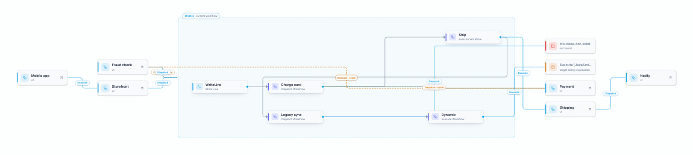

# The designer

The editor takes over the application header, so there is one toolbar rather than two: a breadcrumb
with the editable workflow name, a Designer and Code switch, a View menu, the save state, and
Publish and Run.

## Containers

Three designers, one per container type the engine executes. You pick the container when creating a
workflow.

| Container | Behaviour |
|---|---|
| **Flowchart** (`Elsa.Flowchart`) | A free graph of steps joined by outcome ports. |
| **Sequence** (`Elsa.Sequence`) | An ordered list that runs top to bottom. Reorder by dragging, insert with the `+` buttons. There are deliberately no manual connections. |
| **State machine** (`Elsa.StateMachine`) | States as nodes and transitions as edges. Each state can have an entry and an exit activity; each transition a trigger, a condition and an action. Transitions without a trigger are automatic and evaluated in declaration order, and the first state is the initial one. |

Containers nest. A branch of an `If`, a state's entry, or a transition's action can hold a flowchart,
a sequence or another state machine, opened from the breadcrumb.

## Building a workflow

- **Quick-add palette.** Press `A`, double-click the canvas, click `+` on a step's port, or `+` on a
  connection to search and place an activity. It is wired in automatically, and recently used
  activities are listed first.
- **Context toolbar** on the selected step: add next, rename (`F2` or double-click), duplicate, mark a
  trigger as the starting point, open settings, delete. Dispatch and Execute Workflow steps also offer
  **Open target workflow**, which navigates to the workflow they call and leaves a way back.
- **Connections.** A step's in-port sits on the same row as its out-port, so aligned steps connect
  with a straight line. While dragging, a step snaps to neighbouring ports and edges within a few
  pixels, and dashed helper lines show the alignment. Steps with several outcomes let you choose which
  outcome to append to or connect from, and "Connect to…" wires a step to an existing one with a click.
- **Auto layout** rearranges the current container with a layered layout.

## Live checks

Disconnected steps and dangling connections are flagged on the canvas and summarised in the header.
Clicking a finding selects the offending step. Server-side validation still runs on save and publish.

## Data flow

The Variables and I/O tabs show how many steps write (↑) and read (↓) each item. Hovering highlights
those steps on the canvas, and clicking lists them. The data-flow overlay, available from the View
menu or the database icon, draws dotted associations from writers to readers and tags each step with
the data it uses.

Expression editors autocomplete `variables.X`, `getX()`, `getInput('X')` and
`getOutputFrom('Step', 'Output')`.

## Call context

Workflows form a hierarchy: one definition can start another through Dispatch Workflow or Execute
Workflow. Turn on **Call context** from the View menu, or the button next to the data-flow toggle, to
see where the current workflow sits in that hierarchy.

The current workflow is drawn inside a box, unchanged. Everything that calls it, directly or
transitively, appears on the left, up to the root workflows. Everything it calls appears on the right,
down to the leaves. Each edge is labelled with the call type, cycles are drawn as dashed back edges,
and two special nodes are called out:

- **Unresolved target**, when the target is computed by an expression and cannot be known statically.
- **Missing**, when the referenced definition does not exist or cannot be loaded.

Every external node has a drill-in action that opens that workflow with the mode still on. If the
current workflow has unsaved changes, you are asked whether to save, discard or cancel first.

The graph is built once per session from existing endpoints and reused, so drilling between workflows
does not refetch it. Nothing is loaded while the toggle is off. Safety limits on depth, node count,
requests and time stop large hierarchies cleanly and mark truncated branches.

## Input syntaxes

Every activity input can be a literal or an expression. The syntax switcher next to a field offers
JavaScript, Liquid, C# and Python, plus two bindings that are edited with a picker rather than as
text:

- **Variable** binds the input to a workflow variable.
- **Workflow input** binds it to an input declared on the workflow.

Lists are stored by the engine as a JSON string and are read back into checkboxes, so workflows
authored by older Elsa versions render correctly.

## Keyboard shortcuts

| Keys | Action |
|---|---|
| `A` | Open the quick-add palette |
| `F2` | Rename the selected step |
| `⌘/Ctrl + Z`, `⇧⌘/Ctrl + Z` | Undo, redo |
| `⌘/Ctrl + C`, `X`, `V` | Copy, cut, paste |
| `⌘/Ctrl + D` | Duplicate |
| `⌘/Ctrl + A` | Select all in the container |
| `⌘/Ctrl + S` | Save |
| `Delete` / `Backspace` | Delete selection |

The keyboard icon in the editor header lists them in the app.

## Saving

Auto-save is on by default and can be turned off from the overflow menu. Leaving with unsaved changes
asks for confirmation. Publishing creates a new version; older versions stay available from the
Versions tab and can be viewed or reverted.
