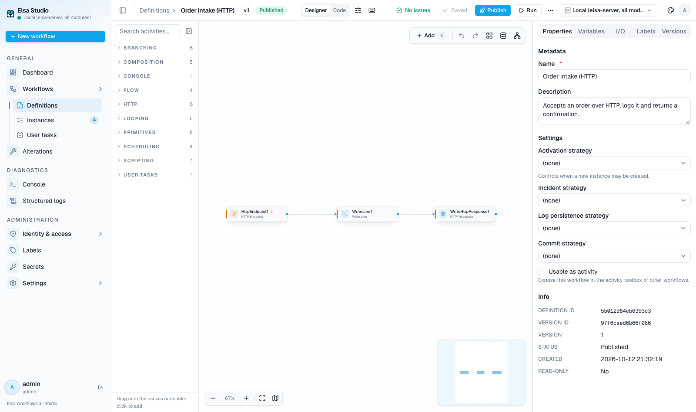
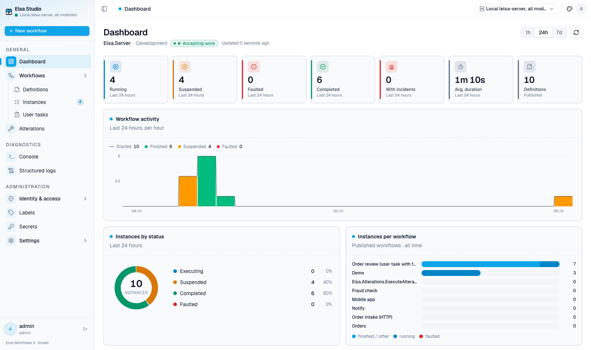
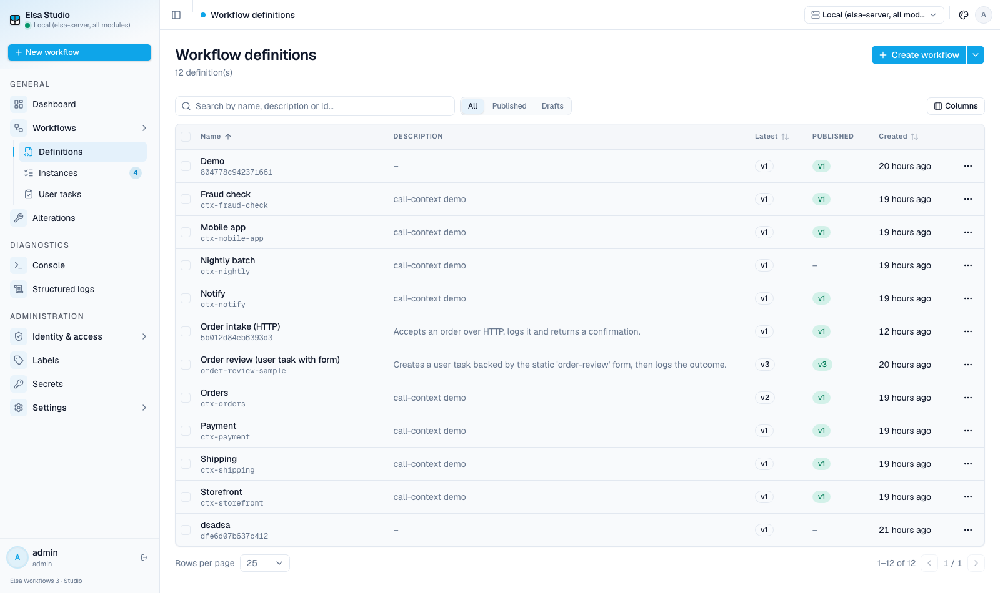
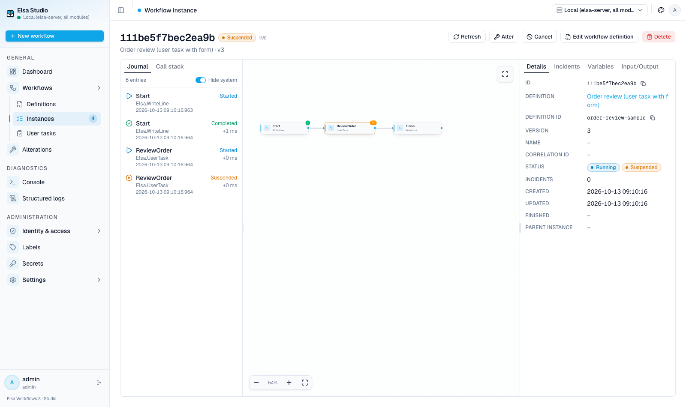
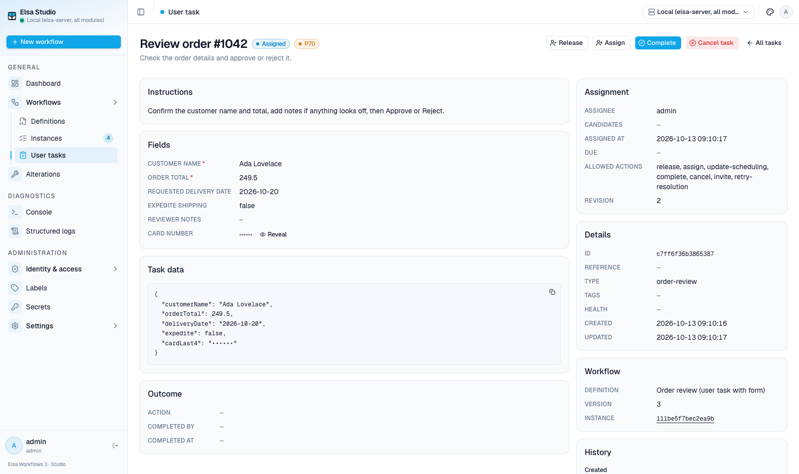
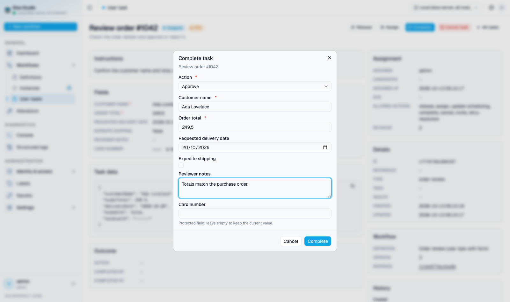
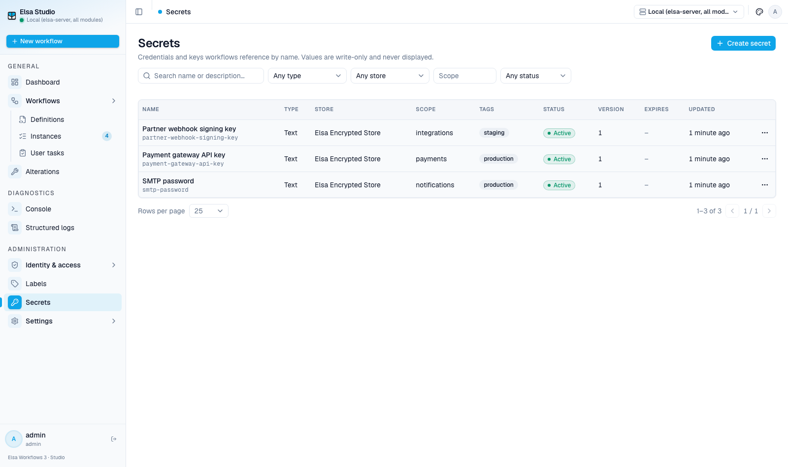
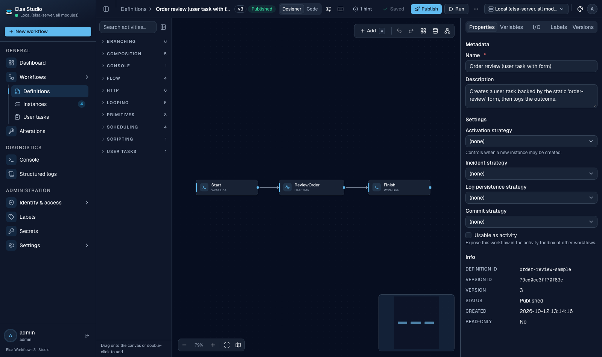

<div align="center">
  
  <h1>Elsa React Studio · Preview</h1>
  <p><strong>A modern, component-based web studio for <a href="https://github.com/elsa-workflows/elsa-core">Elsa Workflows 3.x</a>.</strong></p>
  <p>Design, run and operate workflows from the browser: a visual designer, live instance inspection, human tasks, secrets, diagnostics and more.</p>
  <p>
    
    
    
    
    
  </p>
</div>



This opt-in frontend targets **3.11.0 Preview**. The Blazor Studio remains the default
through 3.x. [Source provenance](../../docs/integration-program/studio-react-source-import.md)
retains donor history and attribution; the [delivery record](../docs/specs/react-studio-preview/plan.md)
tracks production module extraction and remaining Preview requirements.

The 16 feature libraries, aggregate hosting library, host, standalone server and
host tests under `dotnet/` belong to `Elsa.sln` and `Elsa.ReactStudio.slnf`.
Build frontend assets before packing or running browser/endpoint tests.
See [feature packages and hosting](docs/feature-packages.md).

## Overview

Elsa Studio is a standalone front end for the Elsa Workflows engine. It is a client-rendered
application that talks directly to the Elsa REST API, so it can be deployed next to any Elsa server
without changing the engine.

Three modules are always available: the **dashboard**, **workflow definitions** and **workflow
instances**. Everything else is optional and switched on per deployment through configuration, and is
hidden automatically when the connected backend does not have the matching feature installed.

| | |
|---|---|
| **Visual designer** | Flowchart, sequence and state machine containers, a searchable quick-add palette, auto layout, live validation and keyboard-driven editing. |
| **Operations** | Instance viewer with the execution journal, activity state, incidents and variables, plus bulk cancel and retry through alterations. |
| **Human tasks** | A task inbox with assignment, dynamic forms, protected fields and completion outcomes. |
| **Governance** | Users, roles and permissions, labels, and write-only secrets that workflows reference by name. |
| **Insight** | A call-context view of how workflows invoke each other, data-flow overlays, console and structured logs. |

## Quick start

**Prerequisites:** .NET SDK 10, Node.js 22.12 or newer, pnpm 10, and a running Elsa server with CORS open to the
studio's origin.

```bash
pnpm install --frozen-lockfile
pnpm build
pnpm host                # ASP.NET host on port 5201, mounted at /studio-preview
# In another terminal: pnpm dev  (Vite on port 5173; config proxied to the host)
```

Point `servers[0].url` in `studio.config.json` at your Elsa API, which is typically something like
`https://localhost:5001/elsa/api`, then sign in. The default authentication provider is Elsa Identity,
so a username and password is all you need.

New to the project? Start with the [Getting started guide](docs/getting-started.md).

## Documentation

| Guide | What it covers |
|---|---|
| [Getting started](docs/getting-started.md) | Install, run, connect to a server, first sign-in. |
| [Configuration](docs/configuration.md) | **Adding servers**, authentication providers, feature flags, theming, environment variables. |
| [Modules](docs/modules.md) | What every module does, how to enable it, and how to build a new one. |
| [Parity audit](docs/parity.md) | Verified editor behavior, evidence boundaries and linked Preview gaps. |
| [Activity settings](docs/activity-settings.md) | Commit, log persistence, resilience, task and version settings; instance retry history. |
| [Designer](docs/designer.md) | Containers, the quick-add palette, data flow, call context, keyboard shortcuts. |
| [Deployment](docs/deployment.md) | Docker image, standalone output, runtime configuration. |
| [Troubleshooting](docs/troubleshooting.md) | CORS, hidden modules, sign-in failures, workflows from older Elsa versions. |
| [Architecture](docs/ARCHITECTURE.md) | Module contract, data access, designer internals, conventions. |

## Screenshots

### Dashboard

Throughput, status breakdown and per-workflow activity for the connected server.



### Workflow definitions

Published and draft versions, labels, filtering and a column picker.



### Call context

See where a workflow sits in the hierarchy: every workflow that calls it on the left, everything it
calls on the right, with the call type on each edge, cycles highlighted, and unresolved or missing
targets called out. Drill into any node to open that workflow.


### Instance viewer

Replay a run against the diagram, with the journal, activity state, variables and incidents.



### Human tasks

Task detail with instructions, form fields, protected values and the recorded outcome.



Completion renders the task's pinned form, validates required fields and submits the response back to
the workflow.



### Secrets

Credentials workflows reference by name. Values are write-only and never displayed.



### Themes

Five palettes and light, dark or system appearance, selectable per user from the header.



## Configuration at a glance

Configuration is resolved on the server for every request, so a container can be reconfigured without
a rebuild. See [Configuration](docs/configuration.md) for the full reference.

```jsonc
{
  "title": "Elsa Studio",
  "servers": [
    { "name": "Local", "url": "https://localhost:5001/elsa/api" },
    { "name": "Staging", "url": "https://staging.example.com/elsa/api", "tenantId": "tenant-1" }
  ],
  "auth": { "provider": "elsa-identity" },
  "features": {
    "environments": { "enabled": true },
    "labels": { "enabled": true },
    "secrets": { "enabled": true },
    "security": { "enabled": true },
    "alterations": { "enabled": true },
    "user-tasks": { "enabled": true },
    "settings": { "enabled": true },
    "appearance": { "enabled": true },
    "diagnostics-console-logs": { "enabled": true },
    "diagnostics-structured-logs": { "enabled": true }
  },
  "ui": { "defaultTheme": "system", "theme": "classic", "pollIntervalMs": 5000, "defaultPageSize": 25 }
}
```

Nothing in this document is secret: it is shipped to the browser.

## Project layout

```
src/
  main.tsx                  Vite entry and History API router
  config/                   runtime configuration provider
  lib/
    api/                    TanStack Query provider and host hooks
    auth/                   config/server adapter for the shared auth provider
dotnet/modules/
  Elsa.ReactStudio.*/Client/ one independent ESM entry and module-owned styles per feature
dotnet/Elsa.ReactStudio/     feature selection and opt-in hosting
packages/
  sdk/                      Preview registration contracts and host runtime
  api-client/               HTTP client, typed endpoints and workflow models
  auth/                     shared strategies, React context and permissions
  ui/                       shared primitives and theme styles
samples/weather-module/     external consumer compiled against packed packages
```

## Scripts

| Command | Purpose |
|---|---|
| `pnpm dev` | Vite development server on port 5173; run the configuration host too. |
| `pnpm host` | ASP.NET host on port 5201; reads the source configuration file per request. |
| `pnpm build` | Type check and build ESM/CSS for the ASP.NET host. |
| `pnpm test:browser` | Browser tests against the built ASP.NET host. |
| `pnpm test` | Unit tests (Vitest). |
| `pnpm lint` | ESLint. |
| `pnpm typecheck` | Type check. |
| `pnpm test:packages` | Compile and render a separate consumer using four packed packages. |
| `pnpm docs:api` | Generate the Preview API reference under `docs/api/`. |

## Docker

```bash
docker build -f studio/react/Dockerfile -t elsa-react-studio:preview . # repository root
docker run -p 8080:8080 \
  -e STUDIO_SERVER_URL=https://elsa.example.com/elsa/api \
  -e STUDIO_FEATURES=labels,secrets,security \
  elsa-react-studio:preview
```

Mount a `studio.config.json` at `/app/studio.config.json`, or pass the whole document in
`STUDIO_CONFIG`, for the full configuration. See [Deployment](docs/deployment.md).
