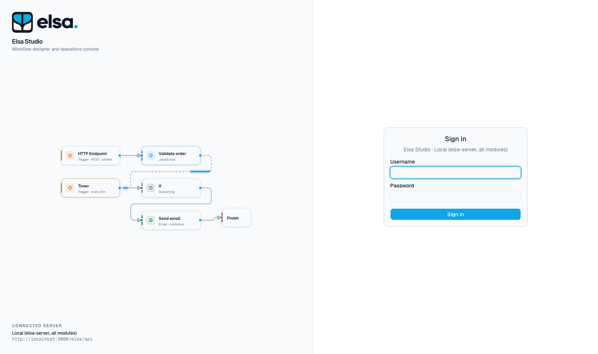

# Getting started

This guide takes you from a clone to a signed-in studio connected to an Elsa server.

## Prerequisites

| Requirement | Version | Notes |
|---|---|---|
| Node.js | 22.13 or newer | Used to build Vite assets. |
| .NET SDK | 10 | Runs the ASP.NET host. |
| pnpm | 10 | The repository pins `pnpm@10.33.0` through `packageManager`. |
| Elsa server | 3.x | Must expose the REST API and allow the studio's origin through CORS. |

## Install and run

```bash
pnpm install --frozen-lockfile
pnpm build
pnpm host
# Another terminal in studio/react:
pnpm dev
```

The Vite development server uses port 5173 and proxies runtime configuration to the
ASP.NET host on port 5201. The host also serves production assets under `/studio-preview`.
It reads `studio.config.json` on each configuration request, so file changes need a
browser reload. Rebuild the frontend and restart the host after changing production assets.

## Point it at a server

Open `studio.config.json` and set the first entry's `url` to your Elsa API. The base URL ends with the
API route prefix, which is `/elsa/api` by default:

```jsonc
{
  "servers": [
    { "name": "Local", "url": "https://localhost:5001/elsa/api" }
  ],
  "auth": { "provider": "elsa-identity" }
}
```

To work against several backends at once, see
[adding a server](configuration.md#adding-a-server) in the configuration guide.

### The server must allow your origin

The studio runs in the browser and calls the Elsa API directly, so the API has to return CORS headers
permitting `http://127.0.0.1:5173` for `pnpm dev`, or `http://127.0.0.1:5201` for the ASP.NET host. The reference host in `elsa-core` already allows any origin in
development. If sign-in fails with no status code in the network tab, this is almost always the cause,
and [Troubleshooting](troubleshooting.md#cors-requests-are-blocked) explains how to confirm it.

## Sign in



The default provider is Elsa Identity, which signs in with a username and password against
`/identity/login` and keeps the session alive with a silent refresh. A development Elsa server
typically starts with `admin` / `password`.

Four other providers are supported, including API key, OpenID Connect and Elsa's external
authentication broker. See [authentication](configuration.md#authentication).

## First steps

Once signed in:

1. **Dashboard** shows throughput and status for the connected server.
2. **Workflows → Definitions** lists what exists. Use **New workflow** in the sidebar to create one,
   choosing a flowchart, sequence or state machine.
3. Build the workflow in the [designer](designer.md), then **Publish** it.
4. **Run** it from the editor header, and follow the run under **Workflows → Instances**.

## What you see depends on the backend

Optional modules are hidden unless two things are true: the module is enabled in configuration, and
the connected server reports the feature it needs. A studio pointed at a minimal Elsa server will
legitimately show fewer sidebar entries than one pointed at a full installation.

[Modules](modules.md) lists every module with the server feature it requires.

## Verify your changes

```bash
pnpm test          # unit tests
pnpm lint          # ESLint
pnpm typecheck   # type check
```
