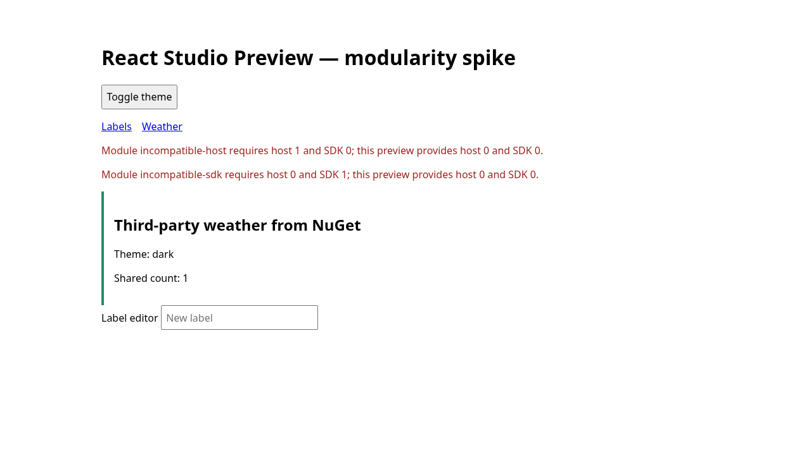

# React Studio modularity spike

Temporary architecture proof for [#8839](https://github.com/elsa-workflows/elsa-core/issues/8839),
part of [#8859](https://github.com/elsa-workflows/elsa-core/issues/8859). This is independently
authored sample code; it does not import or relicense the React Studio donor.

The proof uses ASP.NET Core and CShells, browser import maps, a typed SDK v0 with
route/navigation/UI-hint slots, a Labels module, and a third-party Weather module.
It packs all three libraries to a local NuGet feed before restoring the host.
The host has **only package references**: neither module's source project is a
build dependency. JavaScript and CSS are embedded resources in the package assemblies.

This sample is deliberately outside `Elsa.sln` and global packing: its package-only
consumer must restore after the local packages exist, and none of its temporary
`*-spike` packages should enter product releases. Remove the sample when #8839's
proof is superseded by equivalent coverage of the production React Studio packages.

## Run the proof

Prerequisites: .NET 10 SDK, Node 22.12+, pnpm 10.33.0, and Chromium. The runner defaults
to `/usr/bin/chromium`; override `CHROMIUM_PATH` for another installed Chromium.
NuGet dependencies use nuget.org; the isolated `NuGet.Config` does not require Elsa's
preview feed because this sample does not reference the workflow runtime.

```sh
cd studio/samples/ReactStudio.Modularity
bash verify.sh
```

The runner builds production ESM assets, packs the libraries, restores/builds the
host against those packages using a fresh cache, then runs Playwright against
enabled, feature-disabled and Vite-development hosts. It verifies shared query
state and theme across the two separately bundled modules, UI-hint registration,
versioned asset URLs, rejection of an incompatible module with a visible diagnostic,
feature-specific manifest/assets, deep links and History API navigation, a nonce
CSP, and a proxied Vite WebSocket/hot update that preserves query state.

The host supports `--Spike:ThirdPartyEnabled=false` and
`--Spike:ViteUrl=http://127.0.0.1:5173`. Vite is proxied under `/studio-preview/vite/`
and the shell is mounted under `/studio-preview`. The fixed development ports
5101–5103 and 5173 belong to this bounded proof, not a production hosting API.

Browser dependency requests resolve through one import-map entry URL that owns
React, React DOM, TanStack Query and the SDK contexts. Module builds externalize
those packages. Development uses Vite's shared dependency graph instead, with
the same SDK source and explicit deduplication.

Verified on 2026-10-20 with .NET SDK 10.0.402, Node 24.19.0, pnpm 10.33.0 and
Chromium 154: type checking, all four Vite bundles, three NuGet packs, the consuming
host build and all three Playwright tests passed. `pnpm audit` reported zero known
vulnerabilities. This is current-instance evidence, not hosted CI or release proof.



## Limits

SDK v0 is experimental and unversioned as a public API. This proof is not the donor
import, the Vite migration, full SDK v1, authentication, dynamic package installation,
an authorization boundary for module assets, localization or a production release.
Feature gating is exercised at startup through actual CShells feature activation.
Production support for additional mount paths, reloads, multiple tenants and package
lifecycles belongs to the subsequent epic children.
